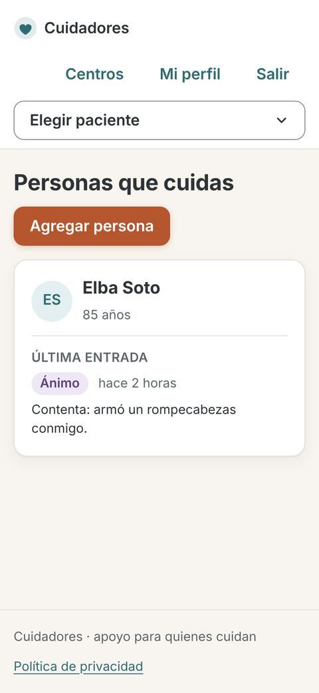
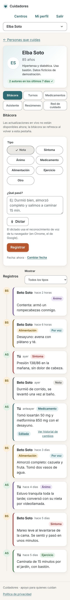
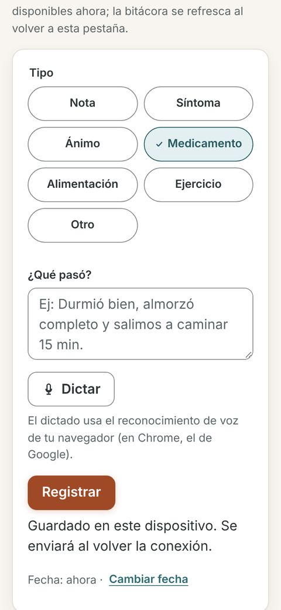
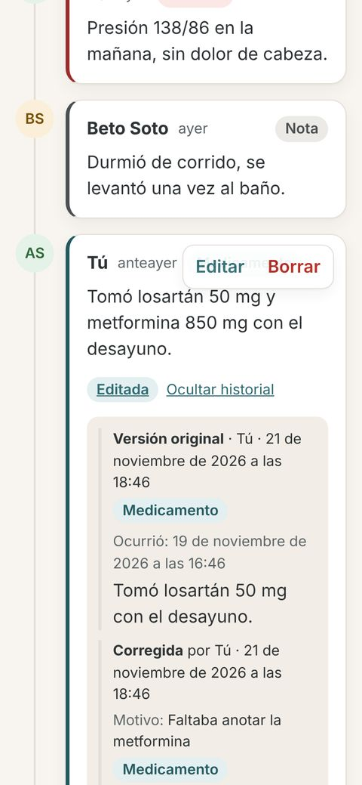
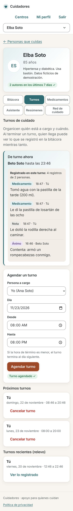
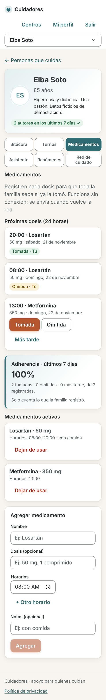
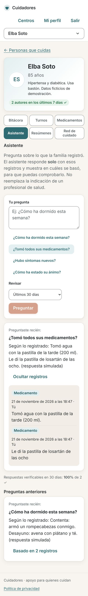
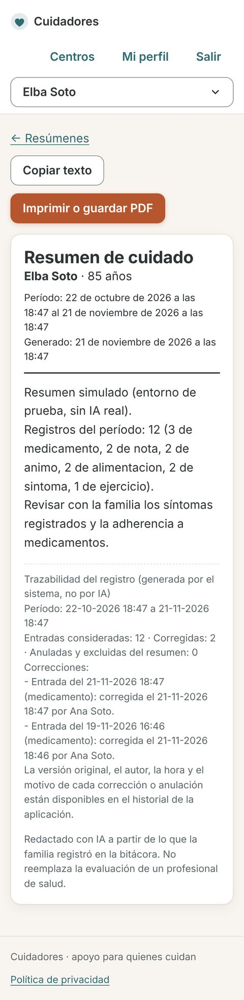
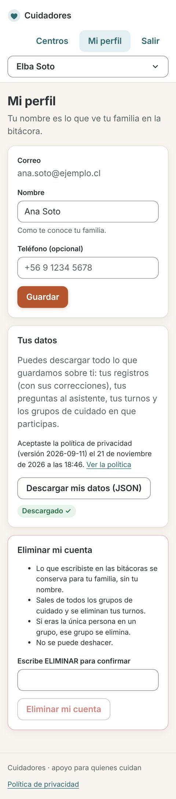
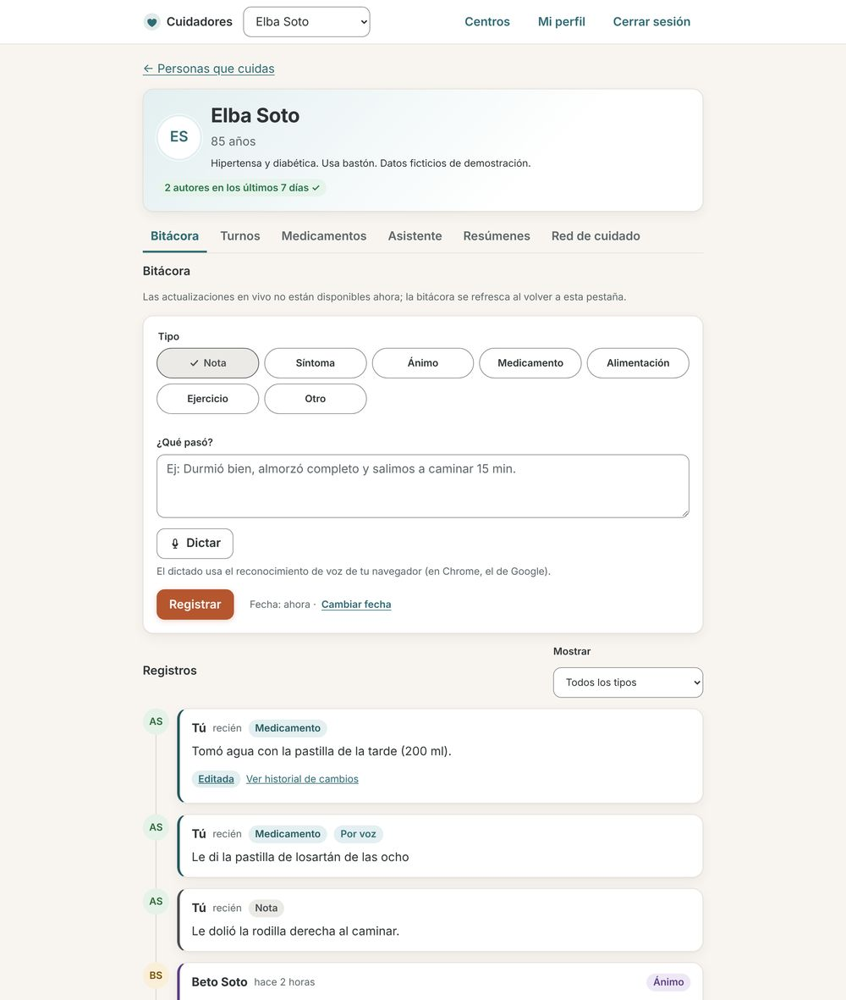

# Manual de uso · Cuidadores

Guía corta para las familias que cuidan a una persona dependiente.
Funciona en el celular y en el computador.

> Las imágenes muestran **datos ficticios** en un entorno de prueba. Las
> respuestas de la inteligencia artificial en las imágenes son simuladas.

---

## 1. Primeros pasos

1. **Crea tu cuenta** con tu correo y una contraseña.
2. **Lee y acepta la política de privacidad.** Explica qué datos guardamos y
   con quién se comparten.
3. **Agrega a la persona que cuidas** ("Agregar persona"): nombre y, si
   quieres, fecha de nacimiento y notas importantes (por ejemplo, alergias).
4. **Invita a tu familia** en "Red de cuidado" con su correo. Cada persona
   necesita su propia cuenta.

Roles: quien **administra** invita y organiza; quien **cuida** registra y
toma turnos; quien solo **lee** puede ver todo, pero no escribe.

## 2. Anotar en la bitácora

En **Bitácora**:

1. Elige el **tipo**: nota, síntoma, ánimo, medicamento, alimentación,
   ejercicio u otro.
2. Escribe **qué pasó**, con tus palabras.
3. Presiona **Registrar**. La hora es la de ahora; si fue antes, toca
   "Cambiar fecha".

**Dictar:** si tu teléfono lo permite, toca **Dictar** y habla. El texto
aparece solo y la app sugiere el tipo (por ejemplo, "Medicamento" si dices
"pastilla"). Puedes cambiarlo antes de registrar.

Cada registro muestra quién lo escribió. Así la familia sabe quién estuvo y
qué observó.

## 3. Sin internet

Puedes registrar igual. Aparece **"Sin conexión"** arriba y tu registro dice
**"Pendiente de sincronizar"**. Cuando vuelve la señal se envía solo. No
cierres sesión mientras tengas registros pendientes.

## 4. Corregir o borrar un registro

Toca **Editar** o **Borrar** en un registro tuyo. Siempre se pide un
**motivo** (por ejemplo: "la hora era otra").

Nada se pierde: el registro corregido dice **"Editada"** y en **"Ver
historial de cambios"** se ve la versión original, quién la cambió, cuándo y
por qué. Esto cuida la seguridad de la persona: el equipo de salud puede
confiar en lo registrado.

## 5. Turnos

En **Turnos**:

- **De turno ahora**: quién está a cargo y hasta qué hora, con lo que se
  anotó durante el turno. Quien llega al relevo se pone al día en un minuto.
- **Agendar un turno**: elige persona, día y horario. Si la hora de término
  es menor (20:00 a 08:00), el turno termina al día siguiente.
- **Turnos recientes**: toca "Ver lo registrado" para el resumen de ese turno.

## 6. Medicamentos

En **Medicamentos**:

1. **Agrega** cada medicamento con su dosis y sus horarios.
2. En **Próximas dosis** marca **Tomada**, **Omitida** o **Más tarde**.
   Si otra persona ya la marcó, verás quién fue. También funciona sin
   internet.
3. **Adherencia** muestra el porcentaje de dosis tomadas en la semana.

## 7. Asistente

En **Asistente** puedes preguntar, por ejemplo, "¿Cómo ha dormido esta
semana?". El asistente responde **solo con lo que la familia registró** y
muestra en qué registros se basó (**"Basado en N registros"**), para que
puedas comprobarlo.

- Si no hay información suficiente, lo dice.
- **No reemplaza a un profesional de salud.** Ante una urgencia, llama a un
  servicio de emergencia.

## 8. Resumen para la consulta médica

En **Resúmenes**, elige el período (por ejemplo, últimos 30 días) y toca
**Generar resumen**. Tarda unos segundos. Luego **Ver e imprimir** →
**Imprimir o guardar PDF**.

El resumen trae una nota del sistema con las correcciones del período, para
que el profesional sepa qué cambió y quién lo hizo.

## 9. Centros y farmacias

En **Centros** (arriba) busca por nombre o comuna y filtra por región o
tipo. Desde ahí puedes **llamar** o abrir **Cómo llegar**. Confirma el
horario antes de ir.

## 10. Tus datos

En **Mi perfil**:

- **Tu nombre**: es el que ve tu familia en la bitácora.
- **Descargar mis datos**: un archivo con todo lo que guardamos sobre ti.
- **Eliminar mi cuenta**: escribe ELIMINAR para confirmar. Tus registros se
  conservan para la familia, sin tu nombre. No se puede deshacer.

---

## Preguntas frecuentes

**¿Quién ve lo que escribo?** Solo las personas del grupo de cuidado de esa
persona. Nadie más.

**¿Puedo borrar algo para siempre?** No. Puedes borrarlo de la vista, con un
motivo, pero queda en el historial. Es una medida de seguridad clínica.

**¿El asistente puede equivocarse?** Sí. Por eso muestra los registros en
que se basa. Revísalos y, ante dudas de salud, consulta a un profesional.

**Registré sin internet y no se envió.** Abre la app con señal. Si aparece
"No se envió", el registro tenía un problema: puedes descartarlo y anotarlo
de nuevo.

**¿Funciona en el computador?** Sí, en cualquier navegador.

